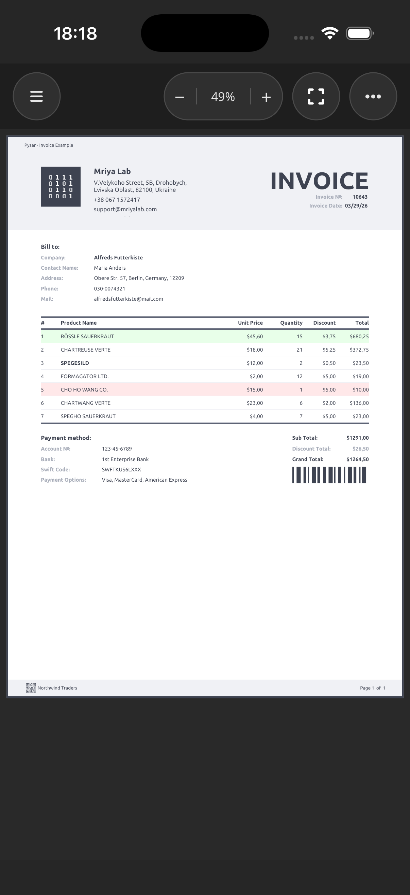

# Pysar.Maui.Sample

> The "MAUI fonts" report requires the platform font integration added in Pysar commit
> `fc4a988` or a later package containing it. This repository currently pins Pysar packages to
> `0.1.63`, which does not include that integration. Update the package references when that
> release is available; a build against `0.1.63` does not verify automatic font resolution.


The Pysar viewer on mobile: a Shell app with one page per report, a compact toolbar, native print
and PDF export through the system share sheet.

Targets `net10.0-android`, `net10.0-ios` and `net10.0-maccatalyst`.

```bash
dotnet build src/Pysar.Maui.Sample -f net10.0-ios -p:RuntimeIdentifier=iossimulator-arm64
xcrun simctl install booted src/Pysar.Maui.Sample/bin/Debug/net10.0-ios/iossimulator-arm64/Pysar.Maui.Sample.app
xcrun simctl launch booted com.mriyalab.pysar.maui.sample
```



## Registering Pysar

`UsePysar` wires the viewer's handlers and takes the same two host-agnostic registrations every
other sample uses:

```csharp
builder
    .UseMauiApp<App>()
    .UsePysar(pysar => pysar
        .AddFonts(ReportBootstrap.RegisterFonts)
        .AddDrawer<QRCode>(new QRCodeDrawer()))
    .ConfigureFonts(fonts =>
    {
        fonts.AddFont("Font Awesome 6 Free-Solid-900.otf", "FontAwesomeSolid");
        // ...
    });
```

`RegisterFonts` still feeds the shared reports (`Ubuntu`, `LibreBarcode128`). A face registered
only with `ConfigureFonts` is also available to a report, by that alias, at `FontStyle.Normal`.
The "MAUI fonts" page uses `OpenSansRegular` and `CookieRegular` that way — there is no `AddFont`
for them. `MauiImage` is still not a report image; `Images/world.svg` is a `ReportAsset`.

## The viewer

```xml
<pysar:ReportView x:Name="Viewer"
                  Report="{Binding Report}"
                  CurrentPage="{Binding CurrentPage}"
                  PageCount="{Binding PageCount, Mode=OneWayToSource}"
                  Zoom="{Binding Zoom}"
                  ZoomMode="{Binding ZoomMode}"
                  EffectiveZoom="{Binding EffectiveZoom}"
                  RenderFailed="OnRenderFailed"
                  DocumentPadding="16"
                  PageSpacing="16"
                  PageBorderColor="{StaticResource ChromePageBorder}"
                  PageBorderThickness="2"
                  RenderBudget="256" />
```

`PageCount` flows out of the control (`OneWayToSource`); the view model only reads it.

### Shell drops the native handler

Switching flyout pages tears down the viewer's platform handler, and a report built while the page
was off screen comes back with its tiles already released — a blank page. The page rebuilds the
report when it reappears:

```csharp
protected override void OnAppearing()
{
    base.OnAppearing();

    // A newly created flyout page can finish loading the report before the native scroll
    // view exists; reloading once the page is on screen is what actually paints it.
    if (Viewer.Handler is not null)
        _viewModel.Reload();

    ShowPageIndicator();
}
```

This is the one MAUI-specific quirk in the sample; the rest of the view model is the same code the
Avalonia and WPF hosts run.

## Export and print

Export produces bytes and hands them to the platform share sheet — a phone has no "save to desktop":

```csharp
using Pysar.Export;

var bytes = await _exporter.ExportAsync(
    Report, ExportFormat.Pdf, new PdfExportOptions { PdfA = true });
await _sharer.ShareAsync(bytes, _reportDescriptor.FileName, $"{_reportDescriptor.Title} report");
```

Print goes through `IReportPrinter`, which resolves to the native print dialog on each platform.

## Responsive toolbar

Print and export are direct toolbar buttons on tablet and desktop, and collapse into an overflow
menu on a phone. `OnIdiom` does the switching declaratively:

```xml
<Border IsVisible="{OnIdiom Phone=False, Default=True}" Style="{StaticResource ToolbarPill}">
    <Button Command="{Binding PrintCommand}" Style="{StaticResource ToolbarPillButton}" />
</Border>

<Border IsVisible="{OnIdiom Phone=True, Default=False}" Style="{StaticResource ToolbarPill}">
    <Button Clicked="OnOverflowClicked" Style="{StaticResource ToolbarPillButton}" />
</Border>
```

The zoom pill (`−` / percentage / `+`) always stays visible; tapping the percentage resets to 100 %,
and the fit button toggles between fit-width and fit-page.

## Reports

The flyout is generated from one list, each entry carrying its title, export file name, icon glyph
and factory:

```csharp
public sealed record ReportDescriptor(string Title, string FileName, string FlyoutGlyph, Func<Report> Create)
{
    public static IReadOnlyList<ReportDescriptor> All { get; } =
    [
        new("Invoice", "InvoiceReport.pdf", "file-invoice-dollar",
            () => new InvoiceReport(InvoiceData.CreateDesignInstance())),
        new("Annual", "AnnualReport.pdf", "chart-line",
            () => new AnnualReport(AnnualLedger.CreateDesignInstance())),
        new("Revenue By Customer", "RevenueByCustomer.pdf", "users",
            () => new RevenueByCustomerReport(RevenueReportData.CreateDesignInstance()))
    ];
}
```
